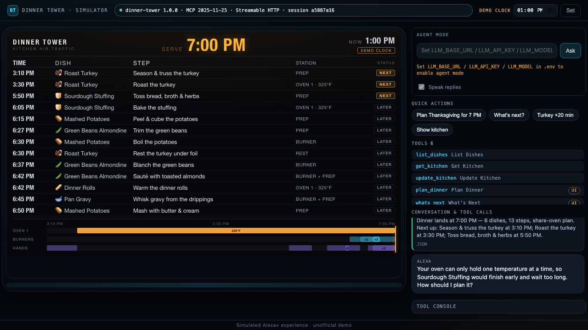
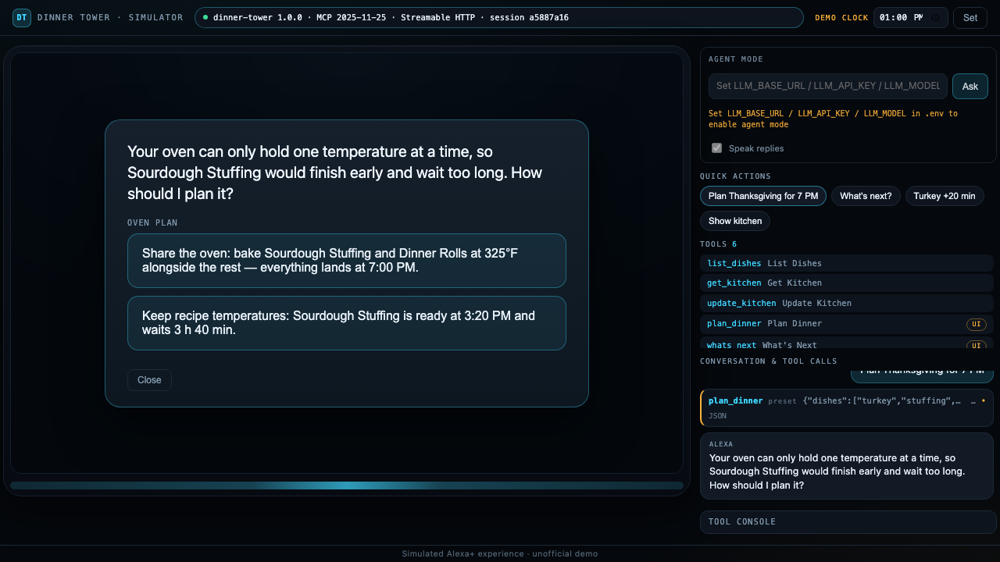
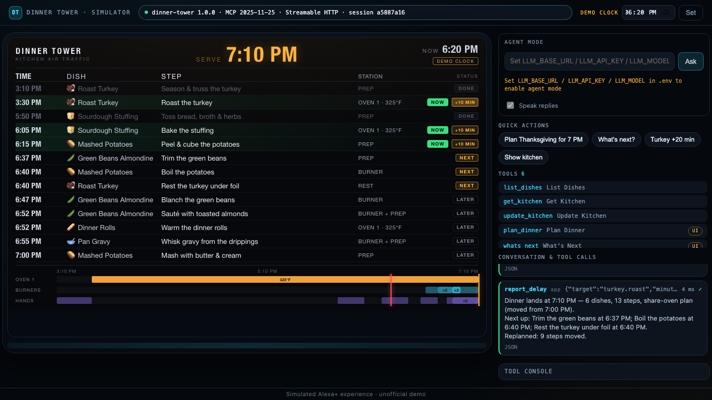
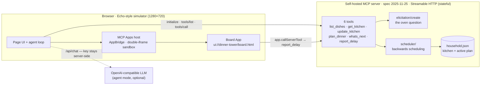

# Dinner Tower

**Air-traffic control for a Thanksgiving kitchen.** One oven, six dishes, one serve time — Dinner Tower schedules every step backwards so everything lands at 7:00 PM.

It is a self-hosted [Model Context Protocol](https://modelcontextprotocol.io) server (spec **2025-11-25**, Streamable HTTP, stateful sessions), an MCP App board, an Agent Skill, and an Echo-style web simulator that is a real MCP client. It is not a recipe chatbot: it owns the plan, answers "what's next?" at 6:20 PM, and replans when the turkey needs twenty more minutes.

## The problem

Thanksgiving dinner is a scheduling problem disguised as cooking. Six dishes have to be ready at the same minute, and the kitchen has one oven that holds **one temperature at a time**, four burners and two pairs of hands.

The recipes collide. The turkey wants 325 °F for three hours; the stuffing wants 350 °F for 45 minutes; the rolls want 400 °F for 12. If you follow each recipe literally, the stuffing is done at 3:20 PM and waits three hours and forty minutes before dinner — or you switch the oven back and forth and lose ten minutes on every switch.

A voice assistant answers one question at a time. It does not hold a six-hour plan, it cannot tell you what to do *next* when your hands are covered in flour, and it forgets everything when the session ends.

## The solution

Dinner Tower puts the plan on the server, where it survives the conversation.

- **Backwards scheduling, with real constraints.** Every step is placed as late as possible before the serve time, around one oven (one temperature at a time, plus the switch window), two oven racks, four burners and two cooks, and never past a dish's hold limit. The result is a departure board: `TIME / DISH / STEP / STATION / STATUS`, with every dish inside its hold window when the serve line arrives.
- **The one question only a human can answer, asked by the protocol.** With one oven something has to give, so `plan_dinner` sends a real MCP **elicitation** in the middle of the tool call: *share the oven* (bake the stuffing and rolls at 325 °F alongside the rest) or *keep recipe temperatures* (the stuffing is ready at 3:20 PM and waits 3 h 40 min). The card in the simulator is the server's `elicitation/create`, not a dialog the UI invented.
- **A board you can also touch.** The plan is an **MCP App** (`ui://dinner-tower/board.html`) rendered in a sandboxed iframe. When your hands are full, the `+10 MIN` button on the current row calls `report_delay` on the server directly — no voice needed — and the board replans in place.
- **It remembers.** The kitchen and the active plan live in a small JSON store on the server. Kill the process, start it again, open a new session at 6:20 PM: `whats_next` still knows the plan, and the board shows the same 7:00 PM line.
- **Any assistant can learn the workflow.** `skills/dinner-tower/SKILL.md` is an **Agent Skill** that teaches a host the four moves — plan, ask, report a delay, read the next step — in the assistant's own voice.

## Demo

**Video:** [Dinner Tower demo — 2:49, English](https://github.com/hanshou101/dinner-tower/releases/tag/demo-v1) (MP4 on the GitHub Release), recorded from the running system; the assistant's lines come from a live LLM (`glm-5.3-flash`). See [How the video is made](#how-the-video-is-made).

Every frame is the real simulator talking to the real MCP server. Three things are simulated, and the video labels all three: the **demo clock** (one afternoon in three minutes), the **voice** (text-to-speech), and the **Alexa+ surface** (Amazon's Alexa+ developer tools are partner-only, so the Echo Show is a web page that speaks MCP).



*1:00 PM. Six dishes, thirteen steps, one 325 °F oven lane, and every dish inside its hold window at the 7:00 PM serve line.*



*The server's own elicitation: one oven, one temperature at a time — share the oven, or keep recipe temperatures and let the stuffing wait.*



*6:20 PM, after `report_delay`: SERVE moves to 7:10 PM, nine steps move with it, and the tool call sits in the log next to the board.*

### How the video is made

```bash
bash scripts/demo/make.sh          # → scripts/demo/out/dinner-tower-demo.mp4
```

The pipeline drives the real simulator in headless Chromium (`DEMO_MODE=1`, agent mode, a real server restart between sessions), records it at 1280×720, synthesises three English voices with macOS `say`, and muxes voice, subtitles and cards with ffmpeg. `make.sh` refuses to finish unless `ffprobe` reports H.264 + AAC, at least 1280×720, and less than 179 seconds.

## Architecture



The server is the only source of truth. The simulator is a protocol client: it negotiates `2025-11-25`, lists tools, calls them over Streamable HTTP, answers elicitation requests, and hosts `ui://` resources through the MCP Apps `AppBridge`. The board is a single self-contained HTML file that receives the tool result as `structuredContent` and can call tools back.

## Quick start

Requirements: Node **20.19+** and npm. No cloud account, no AWS, no Alexa device.

```bash
git clone https://github.com/hanshou101/dinner-tower
cd dinner-tower
npm --prefix server install
npm --prefix sim install
npm --prefix board install
npm --prefix scheduler install        # only needed when running the server tests
cp .env.example .env                  # then fill in the keys below (agent mode only)
bash scripts/dev.sh
```

Open <http://localhost:8080>. `scripts/dev.sh` builds `board/` and the simulator page first, starts the MCP server with `DEMO_MODE=1` (frozen 1:00 PM clock), starts the simulator, and Ctrl-C stops both.

`.env` (copy of `.env.example`; only the file names are committed):

| Keys | When you need them |
| --- | --- |
| `LLM_BASE_URL`, `LLM_API_KEY`, `LLM_MODEL` | Agent mode only — an OpenAI-compatible `chat/completions` endpoint that supports tool calling (e.g. DeepSeek, GLM, Qwen, OpenAI). Read by the simulator server only; they never reach the browser. |
| `PORT` (3001), `HOST` (127.0.0.1), `DEMO_MODE` (1), `DEMO_CLOCK_START` (13:00) | Optional; the defaults above are what the demo uses. |
| `MCP_URL`, `SIM_PORT` (8080), `SANDBOX_PORT` (8081), `DT_DATA_FILE` | Optional overrides for ports and the state file. |

Two ways to drive the simulator:

- **Direct mode — no LLM.** Click a quick action chip (`Plan Thanksgiving for 7 PM`,
  `What's next?`, `Turkey +20 min`, `Show kitchen`) or use the tool console. Every
  chip is a real `tools/call` against the MCP server; the board and the oven
  question are the server's real responses.
- **Agent mode — needs the `LLM_*` keys.** Type a sentence into **Agent mode**
  (e.g. *"I'm hosting Thanksgiving at 7. Turkey, stuffing, mashed potatoes,
  green beans, gravy and rolls."*). The page runs the tool-calling loop, the
  server asks the oven question as a card **you** click, the plan renders on the
  board, and the reply is read aloud (switch **Speak replies** off to mute).
  Without the keys the input is disabled and says what to set — the manual mode
  keeps working.

### A 90-second tour

1. On a fresh start the board is empty. Click **Plan Thanksgiving for 7 PM**.
2. The oven question appears as a card. Pick **Share the oven** — the board fills with thirteen steps.
3. Click **What's next?** — the server reads the live statuses and names the next three steps.
4. Click **Turkey +20 min** (or `+10 MIN` on the current board row) and watch SERVE move; only the steps that have to move, move.
5. Set the demo clock to `18:20`, restart the server (`Ctrl-C`, `bash scripts/dev.sh`), reload the page: the plan is still there in a new session.

`bash scripts/verify.sh` runs the whole check suite (protocol, scheduler golden tables, board, simulator, agent loop, docs).

## Technologies

| Piece | What we used |
| --- | --- |
| Protocol | **MCP spec 2025-11-25**, **Streamable HTTP**, stateful sessions (`Mcp-Session-Id`), form **elicitation**, structured tool output (`outputSchema` + `structuredContent`), `ui://` resources |
| MCP SDK | TypeScript SDK v2 split packages: `@modelcontextprotocol/server` 2.3.1, `client` 2.3.1, `node` 2.1.1, `express` 2.0.2 |
| MCP Apps | `@modelcontextprotocol/ext-apps` 2.0.3 — `registerAppTool` / `registerAppResource` on the server, `App` in the board, `AppBridge` in the host |
| Agent Skill | `skills/dinner-tower/SKILL.md`, loaded into the agent's system prompt at runtime |
| LLM | Any OpenAI-compatible `chat/completions` endpoint with tool calling; agent mode was verified end-to-end against Zhipu AI's `glm-5.3-flash` |
| Runtime | Node 20.19, TypeScript 5.9, Express 5, zod 4, Vite 8 (single-file bundles) |
| Tests & tooling | Vitest 4, Playwright 1.64 (headless), ffmpeg + macOS `say` for the demo pipeline |

## Limitations and what's next

- **The Echo Show is a web page.** Amazon's Alexa+ developer tools (Category SDK, MCP Toolkit, Web Simulator) are available to select partners only, so the demo surface is a simulator that is a genuine MCP client and MCP Apps host. The server itself is the real thing and works with any MCP host (MCP Inspector, Claude, VS Code).
- **The clock is a mock, and it says so.** `DEMO_MODE=1` freezes the time so a three-minute video can walk through an afternoon; the board and the video both show a `DEMO CLOCK` badge.
- **One kitchen, ten dishes.** The catalog is Thanksgiving-shaped and the model covers ovens, racks, burners and cooks — not stove-top space, fridge space or shopping.
- **Deterministic, not optimal.** The scheduler is a greedy backwards packer with a fixed priority rule; it is predictable and testable, but it does not search for the globally shortest plan across two ovens.
- **Next:** a real Alexa+ surface when access opens up, multi-day prep (thaw, brine, pie the day before), grocery quantities, per-household tastes, and more appliances (sous-vide, air fryer, grill).

## 文档组织

- `AGENTS.md`：执行手册（三问三闸、角色、铁律、各角色清单）。任何 agent 进仓库先读它。`CLAUDE.md`、`CODEBUDDY.md` 只是指向它。
- `docs/`：作战文档，按编号读：`00-BRIEF`（比赛要什么）→ `01-SPEC`（我们做什么，唯一事实来源）→ `02-TICKETS`（怎么拆）→ `03-PROCESS`（过程打卡与稽核）→ `04-PROOF`（证据）→ `05-SUBMISSION`（提交包：Devpost 每个字段的可粘贴英文内容）→ `06-RETRO`（回流）。
- `docs/process/README.md`：每张票的六步打卡模板；`docs/process/Tn.md` 是各票的打卡记录，`docs/friction/Tn.md` 是各票亲手踩到的坑（提交时的 friction log 由这些汇总）。
- `scripts/verify.sh`：确定性复验脚本，全部通过退出 0；CI 每次推送都跑它。单项检查在 `scripts/verify.d/NN-*.sh`。
- `scripts/demo/`：演示视频流水线（`make.sh` 一条命令出片，`record.ts` 驱动真实模拟器，`voice.sh` 配音，`mux.ts` 合成并自检 AC-12）。
- `skills/dinner-tower/SKILL.md`：Agent Skill 正文（也是代理模式系统提示的来源）。
- `proof/`：证据文件（截图、日志）。
- 代码目录：`scheduler/`（排程引擎）、`server/`（MCP server）、`board/`（出发看板 MCP App）、`sim/`（Echo 风格模拟器：MCP client + MCP Apps 宿主）、`skills/dinner-tower/`（Agent Skill）；各自带 README。
- `.frac.md`：分形上下文；代码目录长出来以后，各目录自带 `.frac.md`。

## License

MIT — see [LICENSE](LICENSE).
