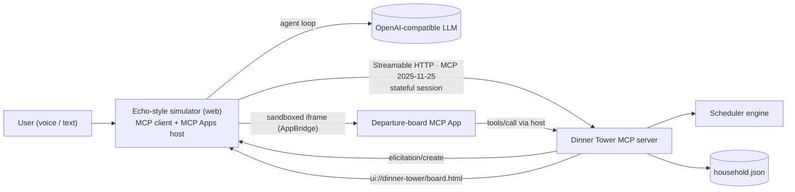

# 01-SPEC：我们做什么（唯一事实来源）

> 作者：主控。執行方不改本文件；覺得它錯了，停下來在結論評論裡說，置 `blocked`。
> 版本：v1.5 · 2026-10-20（北京時間）。規則事實見 `docs/00-BRIEF.md`。v1.1 改了 §3 一句台詞；v1.2 起只在 §10 補記決策。驗收條件從 v1 起沒有改過。
> 產品面向評委的文字（UI、語音、README、視頻）一律英文；本文件的說明用中文。

## 1. 一句話

**Dinner Tower**：給在家請客的人，在 Thanksgiving 這種「一個烤箱、六道菜」的下午，用 Alexa+ 當廚房的**空中交通管制塔**——它排好每一步、在烤箱溫度打架時問你一句、火雞晚了就整桌重排，讓**每一道菜在同一分鐘熱騰騰地「降落」**。

英文 tagline（全項目統一）：*Air-traffic control for your Thanksgiving kitchen — an Alexa+ MCP server that lands every dish hot at the same minute.*

## 2. 評委視角：每條評審標準我們怎麼拿分

| 評審維度（BRIEF §3） | 我們拿分的點 | 演示裡哪一秒看得到 |
| --- | --- | --- |
| Tech Implementation | 自託管 MCP server：spec **2025-11-25**、**Streamable HTTP 有狀態會話**；工具帶 `outputSchema` + `structuredContent`、annotations；**elicitation**（伺服器在工具調用中途反問用戶）；**MCP Apps**（`ui://` 互動看板，看板自己能回調工具）；真正的資源約束排程演算法（烤箱溫度 / 爐頭 / 人手） | 0:25 反問、0:45 看板、1:35 重排、2:10 架構圖 |
| Design | 語音優先 + Echo Show 一眼看懂的「機場出發看板」；手上沾麵粉也只需一句話；看板上大按鈕「+10 MIN」 | 0:45–1:00、1:50 |
| Potential Impact | Thanksgiving 最經典的痛點：一個烤箱、多道菜、要同時上桌；每個週末多菜晚餐都適用；食譜網站 / 智能烤箱廠商可把食譜發佈成步驟圖接入 | 0:00–0:12、2:30 |
| Quality of the Idea | 不是「API 包裝」也不是單輪問答：跨會話記住廚房與進行中的計劃、代理式多步編排、MCP Apps、Agent Skill——正中規則列的 Creative 清單 | 全片；2:10 點名 |
| Friction log 加分（≤10%） | 每張施工票真實記錄踩坑（`docs/friction/`），包裝票整理成提交欄位 | 提交表單 |

## 3. 演示腳本（先寫演示，再寫代碼）

畫面 = 模擬器頁面（1280×720）：左側 Echo Show 風格螢幕（顯示 MCP App 看板），右側對話與工具調用記錄。用戶台詞用英文 TTS 配音 + 字幕；「Alexa」的回答來自**真實運行**的代理模式（LLM + MCP），文字錄下後再用 TTS 配音。總長目標 2:45，硬上限 2:59。

| 時間 | 畫面 | 旁白 / 台詞要點 |
| --- | --- | --- |
| 0:00–0:12 | 標題卡 → 空白出發看板（翻牌動畫）"SERVE --:--" | 旁白："Thanksgiving. One oven. Six dishes. And they all have to land at seven." |
| 0:12–0:25 | 模擬器；演示時鐘 1:00 PM。用戶說話氣泡 | 用戶："Alexa, I'm hosting Thanksgiving at 7. Turkey, stuffing, mashed potatoes, green beans, gravy and rolls." 右側出現 `plan_dinner` 調用 |
| 0:25–0:42 | 螢幕彈出 elicitation 選擇卡（兩個大按鈕，按鈕文字 = §6.2.3 兩條選項文案原樣：「Share the oven: bake Sourdough Stuffing and Dinner Rolls at 325°F alongside the rest — everything lands at 7:00 PM.」「Keep recipe temperatures: Sourdough Stuffing is ready at 3:20 PM and waits 3 h 40 min.」） | Alexa 讀伺服器 elicitation 的 message 原文："Your oven can only hold one temperature at a time, so Sourdough Stuffing would finish early and wait too long. How should I plan it?" 用戶點/說："Share the oven." （台詞以伺服器真實輸出為準，見 §10 v1.1） |
| 0:42–1:02 | 看板翻牌：每一行 TIME / DISH / STEP / STATION / STATUS；底部時間軸烤箱整條 325°F；所有菜的終點線對齊 7:00 PM | Alexa："Done — everything lands at 7:00. First up at 3:10: season and truss the turkey." 旁白："Dinner Tower schedules every step backwards from serve time, around one oven, four burners and two cooks." |
| 1:02–1:22 | 字幕 "Later that afternoon — new session"；演示時鐘跳到 6:20 PM；伺服器重啟過（右側顯示新 session id） | 用戶："Alexa, what's next?" → `whats_next`；看板 NOW 線在 6:20；Alexa："The turkey comes out at 6:30. Next: trim the green beans at 6:27 and boil the potatoes at 6:30." 旁白："It remembers your kitchen and your plan across sessions." |
| 1:22–1:50 | 用戶報延誤 | 用戶："Alexa, the turkey needs twenty more minutes." → `report_delay`；看板翻牌、變動行閃爍；SERVE 7:00 → 7:20。Alexa："No problem. Dinner now lands at 7:20 — I pushed the potatoes, green beans, gravy and rolls, and the stuffing can hold until then." |
| 1:50–2:05 | 手指點看板上「Peel & cube the potatoes」（NOW 行）的「+10 MIN」 | 旁白："The board is an MCP App — it calls the server directly, no voice needed when your hands are full." 只有削馬鈴薯一行翻牌（18:15–18:40），SERVE 仍是 7:20 PM——塔台用既有空檔吸收了延誤（§6.2.6 末條同理） |
| 2:05–2:30 | 架構圖（SPEC §6 的 mermaid 圖重繪成卡片） | 旁白："Under the hood: a self-hosted MCP server on spec 2025-11-25 over Streamable HTTP, elicitation for the oven question, an MCP App for the board, an Agent Skill that teaches any assistant the workflow, and a scheduler that respects every oven temperature." |
| 2:30–2:45 | 結尾卡：名字 + tagline + 倉庫 URL | 旁白："Dinner Tower. Every dish lands on time." |

## 4. 範圍

- **做**：
  1. 排程引擎（純 TypeScript，確定性）：逆向排程 + 烤箱溫度/層架/切換間隔、爐頭數、人手數約束；衝突檢測與選項；進行中重排。
  2. MCP server（Streamable HTTP、有狀態會話、6 個工具、1 個 `ui://` 資源、1 個 prompt、`instructions`）；家庭狀態持久化到 JSON 文件；演示時鐘。
  3. 出發看板 MCP App（單文件 HTML，ext-apps `App`）。
  4. Echo 風格模擬器（網頁）：真正的 MCP client + MCP Apps 宿主（AppBridge + 沙箱 iframe）+ elicitation 表單 + 直連模式（不需 LLM）+ 代理模式（OpenAI 相容 LLM 工具調用迴圈）+ 語音播報（瀏覽器 speechSynthesis）。
  5. Agent Skill：`skills/dinner-tower/SKILL.md`，模擬器代理模式在運行時載入它當系統提示。
  6. 演示視頻流水線（Playwright 錄屏 + macOS `say` 配音 + ffmpeg 合成）、提交包、friction log。
- **不做**：真實 Alexa 設備接入（官方工具不開放）；語音識別輸入（用文字輸入 + 錄製時 TTS 模擬用戶聲音）；購物/下單；多家庭帳號與登錄；雲端部署（FAQ：本地可跑即可）；AWS Builder mini challenge（無 AWS 帳號與額度）；跨午夜的計劃。

## 5. 驗收條件（每條可判定：前提、操作、期望結果）

除另註明外，「黃金廚房」= `{ovens:1, ovenRacks:2, burners:4, cooks:2, ovenSwitchMinutes:10}`；「黃金菜單」= `["turkey","stuffing","mashed_potatoes","green_beans","gravy","rolls"]`（此順序）；`serveAt="19:00"`；菜品數據見 §6.2.1。

- **AC-1 協議與傳輸**：前提：`server` 已安裝依賴。操作：`npm --prefix server start`（預設 `127.0.0.1:3001`），用 `@modelcontextprotocol/client` 的 Streamable HTTP 傳輸連 `http://localhost:3001/mcp`。期望：`initialize` 協商出的 `protocolVersion` 嚴格等於 `"2025-11-25"`；響應頭帶 `Mcp-Session-Id`（有狀態）；同一會話的後續請求成功；`GET /health` 回 `{"ok":true,"name":"dinner-tower","protocolVersion":"2025-11-25"}`。
- **AC-2 工具面**：期望：`tools/list` 恰好含 6 個工具 `list_dishes`、`get_kitchen`、`update_kitchen`、`plan_dinner`、`whats_next`、`report_delay`，每個都有 `title`、`description`、`inputSchema`；`plan_dinner`、`whats_next`、`report_delay` 帶 `outputSchema` 且 `_meta.ui.resourceUri === "ui://dinner-tower/board.html"`；`list_dishes`、`get_kitchen`、`whats_next` 的 `annotations.readOnlyHint === true`。`resources/read("ui://dinner-tower/board.html")` 回 `mimeType` 等於 ext-apps 的 `RESOURCE_MIME_TYPE`、內容是非空 HTML（含 `<html`）。`prompts/list` 含 `thanksgiving`。`initialize` 結果帶非空 `instructions`。
- **AC-3 排程正確性（共用烤箱方案）**：操作：引擎以黃金輸入 + `altSteps={"stuffing.bake","rolls.bake"}` 排程。期望：(a) 任一分鐘人手 ≤ 2、爐頭 ≤ 4、每個烤箱同時最多 2 個步驟；(b) 每個烤箱任一分鐘只有一個溫度，不同溫度之間間隔 ≥ 10 分鐘；(c) 所有 `after` 依賴成立（含跨菜品 `gravy.make` 在 `turkey.roast` 之後）；(d) 每道菜就緒時間在 `[19:00 − holdMinutes, 19:00]`；(e) 與 §6.2.5 表 B 逐步驟時間完全一致；(f) 同輸入跑兩次，JSON 逐字節相同。(a)–(d) 由獨立於引擎的 `validatePlan()` 檢查。
- **AC-4 衝突與選項**：操作：MCP `plan_dinner({dishes: 黃金菜單, serveAt:"19:00"})`，演示時鐘 13:00。期望：(1) 原始溫度方案與 §6.2.5 表 A 一致，`stuffing` 等待 220 分鐘（> 20）→ 有衝突；(2) 客戶端聲明 elicitation(form) 能力時，伺服器在該工具調用中發出 `elicitation/create`（form 模式），選項恰為 `share-oven`、`keep-temps`；回 `accept` + `share-oven` → 工具結果等於 AC-3 方案、`option:"share-oven"`、無衝突；回 `accept`+`keep-temps` 或 `decline`/`cancel` → 結果為表 A、`option:"keep-temps"`、`conflict` 列出等待；(3) 客戶端**不**聲明 elicitation 時，不發 elicitation，結果帶 `conflict.options`（同兩個 id）且 `option:"keep-temps"`；再調 `plan_dinner({..., option:"share-oven"})` 得 AC-3 方案。
- **AC-5 進行中重排**：前提：當前計劃 = AC-3 方案。操作：時鐘 18:20，`report_delay({target:"turkey", minutes:20})`。期望：新 `serveAt="19:20"`、`originalServeAt="19:00"`；逐步驟時間等於 §6.2.5 表 C；18:20 前已開始的步驟除被延誤者外不變；剩餘步驟無一早於 18:20 開始；AC-3 (a)(b)(c) 對新方案成立；`changes` 恰列出表 C 中標「變」的 9 個步驟（含新舊時間）；`revision` 加 1。另：時鐘 18:40、`report_delay({target:"turkey.rest", minutes:15})` → `serveAt="19:15"`，變動步驟等於表 D。
- **AC-6 跨會話狀態**：操作：`update_kitchen({cooks:2})` 與 `plan_dinner`（share-oven）後，結束 server 進程、重啟、建立**新的** MCP 會話。期望：`get_kitchen` 回相同廚房；`whats_next` 回相同 `serveAt` 與逐步驟時間。
- **AC-7 太晚了**：時鐘 18:00，`plan_dinner(黃金菜單, "19:00")` → 工具結果 `isError:true`，文字含 `9:50 PM`（最早可行開飯時間 21:50，算法見 §6.2.4），不改動當前計劃。
- **AC-8 看板 MCP App**：操作：在模擬器裡（直連模式）調 `plan_dinner` 並選 `share-oven`。期望：iframe 內看板顯示 "SERVE 7:00 PM"、13 行步驟（每行有時間、菜名、步驟、工位、狀態）、烤箱泳道標 325°F、NOW 線；時鐘設 18:20 後調 `whats_next`，`turkey.roast` 行狀態為 NOW 且有 "+10 MIN" 按鈕；點它 → 看板經 `app.callServerTool` 調 `report_delay` 並重繪為 "SERVE 7:10 PM"。Playwright E2E 斷言 iframe 內 DOM 文字，截圖存 `proof/`。
- **AC-9 模擬器是真 MCP client 與 Apps 宿主**：期望：頁面顯示伺服器名、版本、協商協議 `2025-11-25`、session id 前 8 位；列出 6 個工具；直連模式的預設動作經 `tools/call` 發出（模擬器工具調用記錄可見請求與耗時）；elicitation 請求渲染為選擇卡，點擊後以 `accept` + 所選值回覆。Playwright E2E。
- **AC-10 代理模式**：前提：`.env` 配好 OpenAI 相容端點（`LLM_BASE_URL`、`LLM_API_KEY`、`LLM_MODEL`）。操作：輸入 "I'm hosting Thanksgiving at 7. Turkey, stuffing, mashed potatoes, green beans, gravy and rolls."。期望：工具調用記錄顯示 `plan_dinner` 的 `dishes` 恰為黃金菜單（順序不限）、`serveAt:"19:00"`；elicitation 卡出現；選 share-oven 後看板渲染；助手回覆文字非空並顯示在對話欄。系統提示包含 `skills/dinner-tower/SKILL.md` 正文（單元測試斷言）。此條需要密鑰：`verify.sh` 中標 `need_local`。
- **AC-11 Agent Skill**：`skills/dinner-tower/SKILL.md` 有 Agent Skills 規範的 frontmatter（`name: dinner-tower`、`description`），正文含 §6.6 列的工作流；被 AC-10 的系統提示真實載入。
- **AC-12 演示視頻**：MP4（H.264 + AAC），≥ 1280×720，`ffprobe` 時長 < 179 秒，英文配音，照 §3 腳本、從真實運行的系統錄製；不含第三方商標/版權音樂；片中標出 "DEMO CLOCK" 與 "simulated Alexa+"。成片放 GitHub Release 附件（不進 Git 歷史）。
- **AC-13 提交包與合規**：`docs/05-SUBMISSION.md` 含 Devpost 每一欄可直接粘貼的英文內容：名稱、tagline、文字說明、Built with、賽道 Alexa+、mini challenge（若 T10 完成則 Open Source）、倉庫 URL、視頻 URL 欄（留給用戶）、**每個工具**的產品反饋、Feature requests、**≥3 條真實 friction log**（來自 `docs/friction/`）。倉庫根有 MIT `LICENSE`；公開前密鑰掃描無命中；只照 README 能在全新 clone 上跑通（舉證票驗）。

## 6. 技術方案

### 6.0 棧與版本（鎖定；改版本要先問主控）

- 執行機：macOS、Node **20.19.x**（fnm）。所有包 `"engines": {"node": ">=20.19"}`，ESM（`"type":"module"`），TypeScript `^5.9`。
- MCP：`@modelcontextprotocol/server@2.3.1`、`@modelcontextprotocol/client@2.3.1`、`@modelcontextprotocol/node@2.1.1`、`@modelcontextprotocol/express@2.0.2`、`@modelcontextprotocol/ext-apps@2.0.3`、`zod@^4.2`、`express@^5`、`cors@^2.8`。**不要用 v1 的 `@modelcontextprotocol/sdk`**（ext-apps 2.x 依賴 v2 拆分包）。
- 測試：`vitest@4.1.12`（**vitest 5 需要 Node 22，不能用**）、`@playwright/test@1.64.1`（E2E 一律 headless，不搶前台）。
- 構建：`vite@8.3.4`、`vite-plugin-singlefile@2.3.4`、`tsx@^4.23`。不用 bun（執行機沒有）。
- 視頻：`ffmpeg-static@5.3.0`（項目內 devDependency）、macOS `say`。
- 抄範例，不憑記憶寫 API：官方倉庫 `modelcontextprotocol/ext-apps` 的 `examples/basic-server-vanillajs/{server.ts,main.ts,mcp-app.html,src/,vite.config.ts}`（伺服器 + App）、`examples/basic-host/{serve.ts,sandbox.html,src/implementation.ts,src/sandbox.ts}`（宿主）。用 `gh api repos/modelcontextprotocol/ext-apps/contents/<path>` 讀。改編的文件頂部註明來源與許可證（Apache-2.0 / MIT）。

### 6.1 倉庫佈局與目錄所有權（並行票只動自己的目錄）

```text
scheduler/        T1  純引擎：src/{types,schedule,options,replan,validate,time}.ts，test/，fixtures/
server/           T2（基建、廚房、菜品目錄、時鐘、健康檢查）+ T4（src/plan/*、規劃工具、看板資源註冊）
  catalog/dishes.json   T2  菜品目錄（§6.2.1 全部 10 道）
  data/                 運行時狀態（gitignore）
board/            T5  看板 MCP App → board/dist/board.html（單文件）
sim/              T3（宿主、直連、elicitation、演示時鐘控件）+ T6（src/agent/*、LLM 代理、語音）
skills/dinner-tower/SKILL.md   T6
scripts/verify.d/NN-*.sh       每票加自己的檢查（verify.sh 會自動 source）
scripts/dev.sh                 T6  一鍵：構建 board → 起 server（DEMO_MODE）→ 起 sim
scripts/demo/                  T9  視頻流水線
docs/process/Tn.md             每票自己的六步打卡（避免多票同改 03-PROCESS.md 衝突）
docs/friction/Tn.md            每票自己的 friction log
```

各包獨立 `package.json` 與 lockfile，**不用 npm workspaces、根目錄不放 package.json**。`server` 以相對路徑 import `../scheduler/src/index.ts`（scheduler 零運行時依賴）；`server` 的 tsx 直接跑 TS。



### 6.2 排程引擎（T1）

#### 6.2.1 數據模型與菜品數據

時間一律用「當天分鐘數」整數（0–1439）；對外 JSON 一律 `"HH:MM"` 24 小時制；計劃不跨午夜。

```ts
type Resource = "oven" | "burner" | "hands";
interface Step { id: string; label: string; minutes: number; uses: Resource[];
  ovenTempF?: number;                       // uses 含 oven 時必填
  alt?: { ovenTempF: number; minutes: number }; // 共用烤箱時的替代做法
  after?: string[]; }                       // 依賴的步驟 id（可跨菜品）
interface Dish { id: string; name: string; icon: string; holdMinutes: number; steps: Step[] } // 最後一步結束 = 該菜就緒
interface Kitchen { ovens: number; ovenRacks: number; burners: number; cooks: number; ovenSwitchMinutes: number }
```

預設廚房 = 黃金廚房 `{ovens:1, ovenRacks:2, burners:4, cooks:2, ovenSwitchMinutes:10}`；`update_kitchen` 合法範圍：ovens 1–2、ovenRacks 1–3、burners 1–8、cooks 1–4、ovenSwitchMinutes 0–30。

菜品（`server/catalog/dishes.json` 收全部 10 道；`scheduler/fixtures/thanksgiving.json` 只收前 6 道，數值必須與此表一致）：

| dish id · name · icon · hold | 步驟 id · label · 分鐘 · uses · 溫度 · alt · after |
| --- | --- |
| `turkey` · Roast Turkey · 🦃 · 30 | `turkey.prep` · Season & truss the turkey · 20 · hands<br>`turkey.roast` · Roast the turkey · 180 · oven · 325 · — · turkey.prep<br>`turkey.rest` · Rest the turkey under foil · 30 · （無） · — · — · turkey.roast |
| `stuffing` · Sourdough Stuffing · 🍞 · 20 | `stuffing.prep` · Toss bread, broth & herbs · 15 · hands<br>`stuffing.bake` · Bake the stuffing · 45 · oven · 350 · {325, 55} · stuffing.prep |
| `mashed_potatoes` · Mashed Potatoes · 🥔 · 30 | `mashed_potatoes.peel` · Peel & cube the potatoes · 15 · hands<br>`mashed_potatoes.boil` · Boil the potatoes · 20 · burner · — · — · peel<br>`mashed_potatoes.mash` · Mash with butter & cream · 10 · hands · — · — · boil |
| `green_beans` · Green Beans Almondine · 🫛 · 10 | `green_beans.trim` · Trim the green beans · 10 · hands<br>`green_beans.blanch` · Blanch the green beans · 5 · burner · — · — · trim<br>`green_beans.saute` · Sauté with toasted almonds · 8 · burner+hands · — · — · blanch |
| `gravy` · Pan Gravy · 🥣 · 15 | `gravy.make` · Whisk gravy from the drippings · 15 · burner+hands · — · — · **turkey.roast** |
| `rolls` · Dinner Rolls · 🥖 · 15 | `rolls.bake` · Warm the dinner rolls · 12 · oven · 400 · {325, 18} |
| `pumpkin_pie` · Pumpkin Pie · 🥧 · 240 | `pumpkin_pie.prep` · Whisk the filling & fill the crust · 15 · hands<br>`pumpkin_pie.bake` · Bake the pumpkin pie · 55 · oven · 350 · {325, 65} · prep<br>`pumpkin_pie.cool` · Cool the pie · 120 · （無） · — · — · bake |
| `salmon` · Garlic Butter Salmon · 🐟 · 5 | `salmon.prep` · Season the salmon · 5 · hands<br>`salmon.roast` · Roast the salmon · 12 · oven · 400 · — · prep |
| `rice` · Jasmine Rice · 🍚 · 20 | `rice.rinse` · Rinse the rice · 5 · hands<br>`rice.simmer` · Simmer the rice · 18 · burner · — · — · rinse<br>`rice.rest` · Rest the rice, lid on · 10 · （無） · — · — · simmer |
| `broccoli` · Roasted Broccoli · 🥦 · 10 | `broccoli.prep` · Cut & oil the broccoli · 8 · hands<br>`broccoli.roast` · Roast the broccoli · 20 · oven · 425 · {400, 24} · prep |

表中 after 簡寫（如 `peel`）指同一道菜的對應步驟（`mashed_potatoes.peel`）；JSON 裡一律寫完整 id。

#### 6.2.2 核心排程 `schedule(input)`（逆向貪心，確定性）

輸入：`dishIds`（去重保序、只留目錄裡有的）、`serveAt`、`kitchen`、`altSteps: Set<stepId>`、`fixed: Map<stepId,{start,end,oven,tempF}>`（已開始的步驟，原樣佔用）、`now: number|null`（下界）、`extra: Map<stepId,number>`（未開始步驟追加分鐘）。

1. **展開步驟**：按 dish 順序、步驟順序。有效分鐘 = （`altSteps` 含它且有 `alt` 則 `alt.minutes`，否則 `minutes`）+ `extra[id]`；有效溫度同理；`after` 只保留本次計劃裡存在的步驟。記 `di`（菜在計劃中的序號）、`si`（步驟在菜中的序號）。
2. `succ(s)` = 依賴 s 的步驟集合。`head(s)` = max over a∈after(s) of `head(a)+min(a)`，無則 0。`tail(s)` = `min(s)` + max over x∈succ(s) of `tail(x)`，無則 `min(s)`。`prio(s)=head(s)+tail(s)`。
3. **佔用表**（每分鐘一格，0–1439）：`hands[m]`、`burners[m]`、每個烤箱 o 的 `ovenTemp[o][m]`（0=空）與 `ovenCount[o][m]`。先把 `fixed` 全部填入。
4. `remaining` = 不在 `fixed` 裡的步驟。循環直到為空：
   - `ready` = remaining 中所有後繼都已放置的步驟；取排序鍵 `(-prio, di, -si)` 最小者 s。
   - `latestEnd` = min(已放置後繼的 start)；無後繼則 `serveAt`。
   - `lowerBound` = max(`now ?? 0`, after(s) 中屬於 fixed 的步驟的 end)。
   - 從 `st = latestEnd − min(s)` 往下逐分鐘到 0，取第一個 `fits(s, st)` 為真者放置（記下烤箱序號）。找不到 → 整個排程不可行（返回不可行）。若 `st < lowerBound` → 標記 `feasible=false`，但照常放置、繼續。
5. `fits(s, st)`，`en=st+min(s)`，要求 `0 ≤ st` 且 `en ≤ 1440`，且 s 用到的每種資源都滿足：
   - hands：∀m∈[st,en) `hands[m] < cooks`；burner：∀m `burners[m] < kitchen.burners`；
   - oven：按 o=0,1,… 取第一個滿足者：∀m∈[st,en) `ovenTemp[o][m]∈{0,t}` 且 `ovenCount[o][m] < ovenRacks`；並且 ∀m∈[max(0,st−g), st) ∪ [en, min(1440,en+g)) `ovenTemp[o][m]∈{0,t}`（g=`ovenSwitchMinutes`）。
6. 放置：所用資源計數 +1；烤箱寫入溫度並 `ovenCount+1`。
7. **就緒與違規**：每道菜 `readyAt` = 其最後一步的 end；`wait = serveAt − readyAt`；`wait < 0` 或 `wait > holdMinutes` 即違規。

#### 6.2.3 衝突選項（`plan_dinner` 用）

- `primary` = 無 alt 的排程。無違規 → `option:"primary"`、`conflict:null`。
- 有違規 → 計算 `share-oven`：`alt=∅`；循環：排程 → 取違規菜品中帶 `alt` 且未加入的步驟加入 `alt` → 無新增則停。若最終 alt 非空、可行、違規數嚴格少於 primary → 提供 `share-oven`。`keep-temps` 永遠提供（= primary）。
- 只有 `keep-temps` 可選 → 不反問，返回 primary 並在 `conflict` 中如實列出等待。
- 選項文案（英文，時間用 12 小時制，如 `7:00 PM`）：
  - message：`Your oven can only hold one temperature at a time, so {違規菜名 and-連接} would finish early and wait too long. How should I plan it?`
  - share-oven：`Share the oven: bake {用到 alt 的菜名} at {alt 溫度}°F alongside the rest — everything lands at {serveAt}.`
  - keep-temps：`Keep recipe temperatures: {菜名} is ready at {readyAt} and waits {X h Y min}.`（多道用 `; ` 連接）

#### 6.2.4 太晚了（AC-7）

`plan_dinner` 以 `now`=時鐘作下界。若 primary 不可行：分別對「無 alt」與「全部帶 alt 的步驟都用 alt」兩種情形，從 `serveAt+5` 起以 5 分鐘為步長找第一個可行（忽略等待違規）的時間，取兩者較早者，回 `isError:true`：`Too late to serve at {serveAt}. The earliest I can land everything is {T'}.`；若到 23:55 都不可行：`… can't fit before midnight.`

#### 6.2.5 重排 `replan`（`report_delay` 用）

1. `target`：先當 stepId 找；否則當 dishId——取該菜「進行中」步驟（start ≤ now < end），沒有則取 start 最早的未開始步驟；都沒有 → 錯誤 `Nothing left to delay for {dish}.`。目標步驟 end ≤ now → 錯誤 `{label} is already done.`
2. `fixed` = 原計劃中 `start < now` 的所有步驟（帶原 start/end/烤箱/溫度）；目標在 fixed 中 → 其 end += minutes；否則 `extra[target] = minutes`。
3. 對 D = 0, 5, 10, …（`serveAt+D ≤ 23:55`）：`schedule(…, serveAt+D, alt=原計劃 altSteps, fixed, now, extra)`；第一個「可行且無違規」者勝出。都不行 → 取第一個可行者（帶違規如實返回）；都不可行 → 錯誤。
4. `changes` = 新舊 start 或 end 不同的步驟，按 (新 start, stepId) 排序，每項 `{stepId, label, from:"HH:MM–HH:MM", to:"HH:MM–HH:MM"}`。`revision+1`；`originalServeAt` 保持首次請求值。

#### 6.2.6 黃金值（引擎單元測試與 MCP 集成測試都要逐步驟斷言）

表 A：primary（原始溫度）。表 B：share-oven（`altSteps={stuffing.bake, rolls.bake}`）。表 C：表 B 在 18:20 `turkey` 延誤 20 → serveAt 19:20。表 D：表 B 在 18:40 `turkey.rest` 延誤 15 → serveAt 19:15。

| stepId | A | B | C | D |
| --- | --- | --- | --- | --- |
| turkey.prep | 15:10–15:30 | 15:10–15:30 | 15:10–15:30 | 15:10–15:30 |
| turkey.roast | 15:30–18:30 · 325 | 15:30–18:30 · 325 | **15:30–18:50** 變 | 15:30–18:30 |
| turkey.rest | 18:30–19:00 | 18:30–19:00 | **18:50–19:20** 變 | **18:30–19:15** 變 |
| stuffing.prep | 14:20–14:35 | 17:50–18:05 | 17:50–18:05 | 17:50–18:05 |
| stuffing.bake | 14:35–15:20 · 350 | 18:05–19:00 · 325 alt | 18:05–19:00 | 18:05–19:00 |
| mashed_potatoes.peel | 18:15–18:30 | 18:15–18:30 | 18:15–18:30 | 18:15–18:30 |
| mashed_potatoes.boil | 18:30–18:50 | 18:30–18:50 | **18:50–19:10** 變 | 18:30–18:50 |
| mashed_potatoes.mash | 18:50–19:00 | 18:50–19:00 | **19:10–19:20** 變 | **19:05–19:15** 變 |
| green_beans.trim | 18:27–18:37 | 18:27–18:37 | **18:47–18:57** 變 | 18:27–18:37 |
| green_beans.blanch | 18:37–18:42 | 18:37–18:42 | **18:57–19:02** 變 | 18:37–18:42 |
| green_beans.saute | 18:42–18:50 | 18:42–18:50 | **19:02–19:10** 變 | **18:57–19:05** 變 |
| gravy.make | 18:45–19:00 | 18:45–19:00 | **19:05–19:20** 變 | **19:00–19:15** 變 |
| rolls.bake | 18:48–19:00 · 400 | 18:42–19:00 · 325 alt | **19:02–19:20** 變 | **18:57–19:15** 變 |

- 表 A 違規：僅 `stuffing`（readyAt 15:20，wait 220 > 20）。表 B、C、D 無違規。
- AC-7：時鐘 18:00、serveAt 19:00 → 無 alt 最早 22:40、全 alt 最早 21:50 → 回 21:50（`9:50 PM`）。
- 另一條可測：表 B 在 18:20 `report_delay({target:"green_beans.trim", minutes:5})` → D=0（serveAt 不變），只有 `green_beans.trim` 變為 18:22–18:37。
- AC-8：表 B 在 18:20 `report_delay({target:"turkey.roast", minutes:10})` → serveAt 19:10，無違規。
- 演示 1:50：表 C 在 18:20 `report_delay({target:"mashed_potatoes.peel", minutes:10})` → D=0（serveAt 仍 19:20），只有 `mashed_potatoes.peel` 變為 18:15–18:40。

### 6.3 MCP server（T2 基建 + T4 規劃工具）

- **傳輸**：`createMcpExpressApp`（`@modelcontextprotocol/express`）+ `NodeStreamableHTTPServerTransport`（`@modelcontextprotocol/node`），路徑 `/mcp`，**有狀態**：`sessionIdGenerator: () => randomUUID()`，按 session id 保存 transport，每個會話一個 `McpServer` 實例（共用同一個存儲）；`DELETE /mcp` 與關閉時清理。**不要照抄官方範例的無狀態寫法**（每請求新建 server）——那樣 elicitation 的回覆會落到新實例上而失效。
- 綁定 `HOST`（預設 `127.0.0.1`）、`PORT`（預設 3001）。CORS：允許任何本機來源；`allowedHeaders` 含 `content-type, mcp-session-id, mcp-protocol-version, last-event-id, authorization`；**`exposedHeaders: ["Mcp-Session-Id"]`**（否則瀏覽器端讀不到 session id）。
- `serverInfo`：`{name:"dinner-tower", title:"Dinner Tower", version:"1.0.0"}`；`instructions`（英文）：說明它是廚房管制塔；不確定菜名時先 `list_dishes`；`plan_dinner` 用 dish id 與 24 小時 `HH:MM`；用戶說某菜晚了就 `report_delay`（target 可用 dish id）；問「下一步」就 `whats_next`；對用戶說話用 12 小時制、兩句以內。
- **持久化**：`DT_DATA_FILE`（預設 `server/data/household.json`）：`{version:1, kitchen, activePlan}`；`activePlan` = `{dishIds, serveAt, originalServeAt, option, altSteps[], steps:[{stepId,start,end,minutes,oven,ovenTempF,usedAlt}], revision}`。寫入用「寫臨時文件再 rename」。
- **時鐘**：`DEMO_MODE=1` 時時鐘凍結在 `DEMO_CLOCK_START`（預設 `13:00`），開放 `GET /demo/clock` 與 `POST /demo/clock {"time":"HH:MM"}`；否則用本機時間的當天分鐘數，且 `/demo/clock` 回 404。
- **工具**（輸入用 zod 定義；輸出 `structuredContent` + 一段給非 UI 宿主讀的英文 `text`）：

| 工具 | 票 | 輸入 | 輸出 / 行為 | annotations | UI |
| --- | --- | --- | --- | --- | --- |
| `list_dishes` | T2 | `{}` | `{dishes:[{id,name,icon,holdMinutes,totalMinutes,ovenTempsF:number[]}]}`（totalMinutes = 步驟分鐘之和） | readOnlyHint | — |
| `get_kitchen` | T2 | `{}` | `Kitchen` | readOnlyHint | — |
| `update_kitchen` | T2 | `Partial<Kitchen>`（範圍見 §6.2.1） | 合併、持久化、回完整 `Kitchen`；越界 → `isError` | idempotentHint | — |
| `plan_dinner` | T4 | `{dishes: string[] (1–8 個目錄 id), serveAt: "HH:MM", option?: "share-oven"\|"keep-temps"}` | §6.2.3/6.2.4 流程；elicitation 見下；成功則存為 activePlan；回 `PlanView` | — | ✓ |
| `whats_next` | T4 | `{}` | 回 `PlanView`；無計劃 → `isError`：`No dinner planned yet. Tell me what you're cooking and when.` | readOnlyHint | ✓ |
| `report_delay` | T4 | `{target: string, minutes: int 1–180}` | §6.2.5；存回；回 `PlanView`（`changes` 非空） | — | ✓ |

- **elicitation**（T4）：只在 §6.2.3 有兩個選項、且 `option` 未給、且客戶端能力 `elicitation` 存在（`{}` 或含 `form`）時，在工具處理中調 `elicitInput`（form 模式）：`message` = §6.2.3 的 message；`requestedSchema = {type:"object", properties:{choice:{type:"string", title:"Oven plan", oneOf:[{const:"share-oven",title:<文案>},{const:"keep-temps",title:<文案>}], default:"share-oven"}}, required:["choice"]}`（2025-11-25 titled enum；若 SDK 校驗拒收 `oneOf`，改用 `enum`+`enumNames` 並記 friction）。`accept` → 用其 choice；`decline`/`cancel` → keep-temps。
- **資源**（T4）：`registerAppResource`：`ui://dinner-tower/board.html`，`mimeType: RESOURCE_MIME_TYPE`，內容讀 `DT_BOARD_HTML`（預設 `board/dist/board.html`，相對倉庫根）；文件不存在 → 回 MCP 錯誤 `Board UI not built. Run: npm --prefix board run build`（不許回假 HTML）。三個帶 UI 的工具用 `registerAppTool` 並設 `_meta.ui.resourceUri`。
- **prompt**（T4）：`thanksgiving` → 一條 user 訊息：`Plan Thanksgiving dinner for 7:00 PM: turkey, stuffing, mashed potatoes, green beans, gravy and rolls.`
- 健康檢查（T2）：`GET /health`（AC-1）。
- 圖標（P2，非驗收項）：2025-11-25 的 `icons`（serverInfo、tool）用 data URI SVG；SDK 不支持就跳過並記 friction。

`PlanView`（`plan_dinner` / `whats_next` / `report_delay` 共用輸出；T4 產出、T5 消費，欄位名與型別不許改）：

```ts
interface PlanView {
  serveAt: string; originalServeAt: string; now: string; demoClock: boolean;
  option: "primary" | "share-oven" | "keep-temps"; revision: number;
  kitchen: Kitchen;
  dishes: { id: string; name: string; icon: string; readyAt: string; waitMinutes: number; holdMinutes: number; ok: boolean }[];
  steps: { stepId: string; dishId: string; dishName: string; icon: string; label: string; start: string; end: string;
           minutes: number; uses: ("oven"|"burner"|"hands")[]; oven: number | null; ovenTempF: number | null;
           usedAlt: boolean; status: "done" | "active" | "upcoming" }[];   // 按 (start, stepId) 排序
  next: string[];                       // 最多 3 個 upcoming stepId，按 start
  conflict: null | { message: string; options: { id: "share-oven" | "keep-temps"; label: string }[];
                     waits: { dishId: string; readyAt: string; waitMinutes: number }[] };
  changes: { stepId: string; label: string; from: string; to: string }[];  // 只有 report_delay 非空
}
```

狀態：`end ≤ now` → done；`start ≤ now < end` → active；否則 upcoming。`oven` 為 1 起算的烤箱編號。

### 6.4 出發看板 MCP App（T5）

- 單文件 HTML（vite + singlefile），用 ext-apps `App`：`ontoolresult` 收 `structuredContent`（PlanView）渲染；按鈕用 `app.callServerTool` 調工具並用其結果重繪。只依賴 ext-apps 的 App API，能在任何 MCP Apps 宿主（模擬器、Claude、VS Code）裡跑。
- 版式（適配 880×550 與更大，深色、高對比、大字）：
  - 頂欄：左 "DINNER TOWER"；中 "SERVE 7:00 PM"（大號琥珀色，serveAt 變化時翻牌）；右 "NOW 6:20 PM" + `demoClock` 為真時顯示 "DEMO CLOCK" 徽章。
  - 主表（翻牌字體）：TIME（start，12 小時制）｜DISH（icon+名）｜STEP（label）｜STATION（`OVEN 1 · 325°F` / `BURNER` / `PREP`（hands）/ `BURNER + PREP` / `REST`）｜STATUS（`DONE` 暗、`NOW` 綠色脈動、`NEXT`（在 `next` 裡）琥珀、`LATER`）。`active` 行右側按鈕 "+10 MIN" → `report_delay({target: stepId, minutes:10})`。`changes` 裡的行高亮 5 秒並觸發翻牌動畫。
  - 底部時間軸：從最早 start 到 serveAt；泳道 OVEN n（色塊按溫度著色並標溫度）、BURNERS（佔用數）、HANDS（佔用數）；紅色 NOW 線、琥珀 SERVE 線。
  - `conflict` 非空時頂部橫幅：message + 兩個按鈕 → `plan_dinner({dishes, serveAt, option})`（不支持 elicitation 的宿主也能在看板裡解決）。
- 翻牌：文字變化時逐字 CSS 翻轉（≤400ms）；`prefers-reduced-motion` 時關閉。

### 6.5 Echo 風格模擬器（T3 宿主/直連 + T6 代理/語音）

- `sim/server.ts`（Express）：`SIM_PORT`（預設 8080）提供頁面與 `POST /api/chat`；`SANDBOX_PORT`（預設 8081）提供沙箱代理頁（照抄 basic-host 的雙 iframe 沙箱模式，不同源）。`MCP_URL` 預設 `http://localhost:3001/mcp`。
- 頁面 1280×720（v1.6 起視覺規格以 `docs/07-UI.md` 第 4 節為準）。**預設是演示模式**：
  - 頂欄 56px：左邊「Dinner Tower」字標加「for Alexa+」標籤；右邊一個「DEMO CLOCK」琥珀描邊膠囊。
  - 左側：820px 的 Echo Show 風格設備框（螢幕 16:10）。空閒時顯示大時鐘、一行 Try 提示和三個示例說法；有 UI 結果時，螢幕裡就是 MCP App 出發看板。反問（elicitation）畫在設備螢幕裡。螢幕下方一條光條，說話或思考時有動畫；不得使用 Amazon 標誌。
  - 右側：380px 對話欄，只顯示最近 3 輪的用戶與 Alexa 氣泡。每條 Alexa 回覆下面一顆灰色工具膠囊（工具名 · 耗時），不顯示 JSON。
  - 頁腳小字：`Simulated Alexa+ experience · unofficial demo`。
  - 開發者資訊只在 `?dev=1` 的 Developer 面板裡出現：連接徽章 `dinner-tower 1.0.0 · MCP 2025-11-25 · Streamable HTTP · session …`、代理模式與模型名、工具清單、工具控制台、原始 JSON、SYSTEM 卡。測試和錄製腳本需要這些元素時，打開 `?dev=1`。
- MCP client（T3）：`@modelcontextprotocol/client` + Streamable HTTP；聲明能力 `elicitation: { form: {} }` 與 ext-apps 的 UI 擴展能力；`listTools` 後顯示；工具結果帶 `_meta.ui.resourceUri` → 讀資源 → AppBridge 渲染（`sendToolInput`、`sendToolResult`），App 發起的 `tools/call` 轉發到伺服器。
- elicitation（T3）：收到 `elicitation/create` → 螢幕上覆蓋選擇卡（message + 每個選項一個大按鈕），並在對話欄記一條 Alexa 氣泡（message 原文）；點擊 → 回 `{action:"accept", content:{choice}}`；關閉 → `cancel`。對 `oneOf`、`enum` 兩種 schema 都要能渲染。
- 直連模式（T3，無需 LLM）：預設動作晶片（真實 `tools/call`）：`Plan Thanksgiving for 7 PM`（plan_dinner 黃金菜單 19:00）、`What's next?`、`Turkey +20 min`（report_delay turkey 20）、`Show kitchen`；另有通用工具控制台（選工具、填 JSON、調用）。
- 演示時鐘控件（T3）：伺服器 `/demo/clock` 可用時顯示時間輸入框，設置後自動調一次 `whats_next`（若有計劃）。
- 代理模式（T6）：瀏覽器端迴圈；`/api/chat` 把 `{messages, tools}` 轉發到 `${LLM_BASE_URL}/chat/completions`（Bearer `LLM_API_KEY`、`model=LLM_MODEL`、`tool_choice:"auto"`、`temperature:0.2`），密鑰只在 sim 伺服器端。MCP 工具 → OpenAI function（name、description、parameters=inputSchema）。最多 6 輪工具調用。系統提示 = `skills/dinner-tower/SKILL.md` 正文（去 frontmatter）+ 伺服器 `instructions` + 固定一句：`You are Alexa+ (simulated) on an Echo Show in the kitchen. Speak in at most two short sentences and use 12-hour times.`。工具結果回填給 LLM：text + 精簡 structuredContent（去掉 kitchen，steps 只留 stepId/start/end/status）。
- 語音（T6）：助手回覆用 `speechSynthesis`（en-US 聲音，若有）朗讀；可關。
- 未配置 LLM 時代理輸入框禁用並提示 `Set LLM_BASE_URL / LLM_API_KEY / LLM_MODEL in .env to enable agent mode`；直連模式照常可用（這是如實的手動模式，不是假代理）。

### 6.6 Agent Skill（T6）

`skills/dinner-tower/SKILL.md`：frontmatter `name: dinner-tower`、`description: Run a multi-dish dinner so every dish is ready at the same minute, using the Dinner Tower MCP tools.`；正文（英文，≤ 80 行）寫明工作流：① 收集菜單與上菜時間（不確定就 `list_dishes`）；② `plan_dinner`；③ 若結果有 `conflict` 且宿主沒反問，把兩個選項讀給用戶並用 `option` 重調；④ 讀出第一步；⑤ 「下一步？」→ `whats_next`；⑥ 「X 晚了 N 分鐘」→ `report_delay`，讀出新的上菜時間與變動；⑦ 說話規範（12 小時制、兩句以內、不念 stepId）。

### 6.7 演示視頻流水線（T9）

`scripts/demo/`：① `record.ts`（Playwright headless，viewport 1280×720，`recordVideo`）按 §3 逐場驅動模擬器（`DEMO_MODE=1`），每場記錄事件時間戳與助手回覆原文到 `timeline.json`；兩場之間按台詞長度留足停頓；跨會話一場要真的重啟 server。② `voice.sh` 用 `say`（用戶一個聲音、Alexa 一個聲音、旁白一個聲音，`say -v '?'` 選本機有的 en_US 聲音）生成配音。③ `mux.ts` 用 `ffmpeg-static` 疊加片頭片尾卡、字幕、配音到對應時間 → `out/dinner-tower-demo.mp4`。成片上傳為 GitHub Release 附件；不進 Git 歷史（`.gitignore` 已排除）。

## 7. 允許的 mock（沒列在這裡的一律不許 mock）

- **演示時鐘**：`DEMO_MODE=1` 時伺服器時間可設定（讓 3 分鐘視頻走完一個下午）；看板與視頻必須顯示 "DEMO CLOCK"。
- **用戶的聲音**：視頻裡用戶台詞由 TTS 合成（無語音識別）；字幕/旁白註明 simulated。
- **Alexa+ 本身**：用模擬器代替（官方工具不開放，見 BRIEF §4）；頁面與視頻標 "Simulated Alexa+ experience"。
- 引擎測試的 `fixtures/thanksgiving.json` 是測試數據，不是 mock。

## 8. 風險與 B 計劃

| 風險 | 信號 | B 計劃 |
| --- | --- | --- |
| 執行機沒有可用的 LLM 端點 | T6 開工即檢查 | 立刻 `blocked` 並在本票請用戶提供一把 OpenAI 相容 key（DeepSeek / GLM / Qwen 皆可）；視頻最壞情況用直連模式錄，旁白如實說明 |
| SDK v2 與 ext-apps 的 API 跟記憶不符 | 編譯/運行錯 | 一律照官方 examples 寫；兩次修不好按鐵律停手交回 |
| elicitation 的 `oneOf` 被 SDK 拒收 | 集成測試失敗 | 改 `enum`+`enumNames`，記 friction |
| LLM 工具調用不穩 | AC-10 偶發失敗 | 錄製腳本對單場重試 ≤3 次；系統提示與 SKILL.md 收緊 |
| 視頻超時或配音錯位 | ffprobe > 179s | 縮短停頓；砍 1:50–2:05 一場 |
| 進度落後 | 10-22 21:00 檢查點 stage 3 未開 | 砍 T10（開源 mini challenge）、砍看板時間軸動畫，保 AC-1～AC-9 + 視頻 |

## 9. 人工步驟（HITL）

| 步驟 | 誰 | 最晚（北京時間） |
| --- | --- | --- |
| 登入 Devpost 並在比賽頁點 "Join hackathon" | 用戶 | 10-22 24:00（越早越好） |
| （僅當 T6 報告執行機無 LLM 端點）提供一把 OpenAI 相容 LLM key，放進執行機倉庫 `.env` | 用戶 | T6 報告後 6 小時內 |
| 準備可發公開視頻的 YouTube（或 Vimeo）帳號 | 用戶 | 10-23 12:00 |
| 下載 Release 裡的成片、上傳 YouTube 設 Public，把鏈接回帖賽道單 | 用戶 | 10-23 20:00 |
| 照 `docs/05-SUBMISSION.md` 逐欄粘貼、點 Submit，截圖回帖 | 用戶 | **10-24 01:00**（硬截止 03:00） |
| 10-24 03:00 至 12-04 不改倉庫 main 與視頻 | 全體 | — |

## 10. 決策記錄

| 日期 | 決定 | 理由 |
| --- | --- | --- |
| 2026-10-20 | 題目定為 Dinner Tower（廚房管制塔），Alexa+ 賽道 | 規則 Creative 清單（跨會話狀態、代理式編排、MCP Apps、Agent Skills）一題全中；廚房是 Echo Show 主場（往屆 Best Multimodal Kitchen）；核心價值在伺服器端確定性演算法 → 弱執行模型也能測得準；評審期 11-09～11-20 正逢 Thanksgiving 前 |
| 2026-10-20 | 走「自託管 MCP server + 網頁 MCP client 演示」路徑，不走純模擬 | FAQ 明確認可網頁 MCP client；保留 runtime 硬鉤，Tech Implementation 更強 |
| 2026-10-20 | 用 SDK v2 拆分包 + ext-apps 2.0.3；有狀態會話 | ext-apps 2.x 只配 v2；elicitation 需要有狀態 |
| 2026-10-20 | 不打 AWS Builder；Open Source mini challenge 作為可選 T10（把模擬器拆成獨立開源倉庫） | 無 AWS 帳號/額度；模擬器填補「官方 Web Simulator 不開放」的生態缺口，順手參賽 |
| 2026-10-20 | 階段 2 同時開 3 張施工票（總綱寫最多 2 張） | 截止前只有 3.5 天；三張票目錄互不重疊（server/plan、board、sim/agent） |
| 2026-10-20 | 過程打卡與 friction 改為每票一個文件（`docs/process/Tn.md`、`docs/friction/Tn.md`） | 並行 PR 同改一張表必衝突；回流時改進模板 |
| 2026-10-20 | 提交前把倉庫轉公開（MIT），不走私有 + 加協作者 | 公開零人工步驟；官方 Final stretch 清單也按公開倉庫寫 |
| 2026-10-20 | v1.1：§3 0:25 台詞改為伺服器 elicitation 的真實 message，選項按鈕用 §6.2.3 文案原樣 | T1（AME-851）指出 §3 與 §6.2.3 不一致；以已實現並測過的 §6.2.3 為準，視頻畫面必須與真實輸出一致 |
| 2026-10-20 | T1、T2 驗收通過後提前放行 T4，不等 T3 | T4 只依賴 T1、T2，且在關鍵路徑上（T6 的 AC-10、T7 都等它）；T5、T6 依賴 T3，仍等 T3 驗收 |
| 2026-10-20 | v1.2：AC-10 的真模型驗證由主控在 macmini2 執行（智譜官方端點 `glm-5.3-flash`，key 不離開該機）。T7 舉證時 AC-10 引用 `proof/AC10-macmini2-*.png` 與本條；執行機只跑腳本化端點那組 E2E | 執行機（第一台 Mac Mini）沒有產品可用的 OpenAI 相容端點（T6／AME-856 實查）。主控在 `7784338`（看板已構建）上跑 `bash scripts/verify.sh`：52 項 ALL PASS，其中 `agent.test.ts` 的 AC-10 用真模型通過；截圖即 `proof/AC10-macmini2-*.png` |
| 2026-10-20 | README Quick start 補 `npm --prefix board install`，`31-agent.sh` 的 README 檢查加上這一項 | T5（AME-855）驗收時照 README 逐字走：`board/` 合併後缺 `board/node_modules`，`scripts/dev.sh` 直接 exit 1。T5 不許改 README，不算 T5 的失敗項，由主控補 |
| 2026-10-20 | 接受 T4 的兩處範圍外改動：`scheduler/src` 18 行相對 import 補 `.js`；T2 測試「恰好 3 個工具」放寬為「包含這 3 個」 | 前者是 server（`NodeNext`）跨包 typecheck 的必要條件，行為不變；後者因工具面合法變成 6 個，「恰好 6 個」由 T4 測試把關。T8 稽核仍照實記錄 |
| 2026-10-20 | 接受 T6 改 `scripts/verify.d/30-sim.sh` 一行（T3 的 `/api/chat` 501 占位檢查改為檢查代理已接上）。T6 退回一次：F1 照 Quick start 起不來（空值 `.env`）、F2 AC-10 E2E 沒等到模型回覆，PR #10 修好 | 占位本來就該由 T6 換掉；F1、F2 是主控驗收時實測發現的 |
| 2026-10-20 | 測試先行的偏差（T3 單元測試沒留「先失敗」記錄；T6 第一輪先實現後補測試）不在驗收時改判，交 T8 照實判 | 驗收看功能與證據；過程合規歸閘 B |
| 2026-10-20 | v1.3：閘 B 有條件通過。T8（AME-858）稽核 3 PASS / 3 FAIL，FAIL 全屬過程；測試先行偏差（T3、T6）接受、不返工 | 紅階段事後補不出真的；行為已由全綠的測試覆蓋，主控驗收時另有獨立探針複驗。教訓回流模板：PR 必附紅→綠輸出。複核寫在 `docs/03-PROCESS.md` 文末 |
| 2026-10-20 | v1.4：T7（AME-857）的 FAIL-1（照 README 啟動後頁面 503：`dev.sh` 不建模擬器頁面，就緒探針又探錯了）由主控直接修，不重開 T6；閘 C 的產品部分（AC-1～AC-11）通過 | 修法只有幾行，T9 錄影要用到；主控已在全新 clone 上照 README 複驗，複核寫在 `docs/04-PROOF.md` 文末 |
| 2026-10-20 | v1.5：公開方式改為「主控在最後從 main 做一份快照，建新的公開倉庫 `hanshou101/dinner-tower`（MIT）」，工作倉庫保持私有，T9 不改倉庫可見性（取代上面「提交前把倉庫轉公開」那一條）。`docs/friction/T6.md` 第一條改寫成中性描述 | 工作倉庫的 PR 歷史與過程文件含內部基礎設施細節（本機密鑰檔的位置、對內部中轉的探測），轉公開會連 PR diff 一起公開。私有倉庫加評審協作者也不行：邀請 7 天就過期，評審期卻在 11-09～11-20 |
| 2026-10-20 | v1.6：頁面版式改成演示模式預設，開發者資訊收進 `?dev=1`；改用設備框，看板與反問卡都畫在螢幕裡，工具膠囊用灰色。視覺規格以 `docs/07-UI.md` 為準（AME-871，閘 D 的 D2 第 2 輪通過）。驗收條件不變，E2E 與錄製腳本改用 `?dev=1` 看開發者元素。第一個示例說法帶上整份菜單 | 用戶 2026-10-20 指出作品 UI 太醜（AME-777 評論 01a158ea），因此加了審美閘 D。主控實測：真模型收到不帶菜單的「plan Thanksgiving dinner for 7 PM」，會先反問菜單 |
