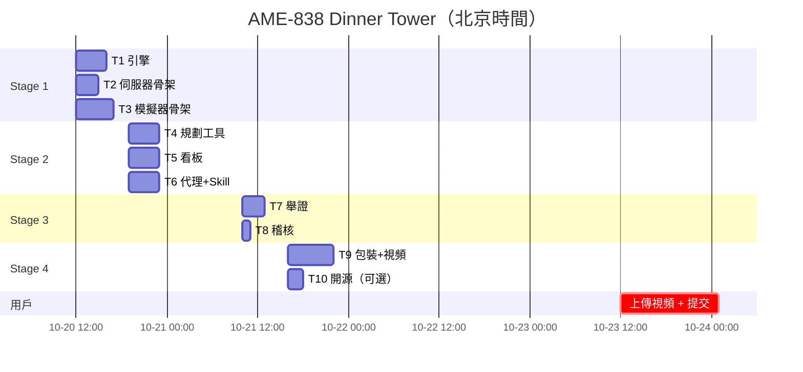

# 02-TICKETS：票据清单

> 作者：主控。每張票是一個縱向切片，帶可判定的驗收條件（引用 SPEC §5 的 AC 編號）。
> 階段 = Multica 子單的 stage：同階段並行，下一階段等上一階段全部驗收後由主控放行。
> AFK = agent 可獨立完成；HITL = 需要人做一步。執行 = 💻🏠【家用|CB-ds41f-1017】日用·MacMini（按票戴角色帽）。
> 截止：北京時間 10-24 03:00；建議提交 10-24 01:00。排期見文末。

| 票 | 標題 | 角色 | 階段 | 依賴 | 驗收條件 | AFK / HITL | 時間盒 | Multica 子單 |
| --- | --- | --- | --- | --- | --- | --- | --- | --- |
| T1 | 排程引擎 `scheduler/`：逆向排程、衝突選項、重排、`validatePlan` | 施工 | 1 | — | AC-3；AC-4/5/7 的引擎部分（§6.2.6 表 A–D 與三條附加黃金值） | AFK | 4h | AME-851 |
| T2 | MCP server 骨架 `server/`：有狀態 Streamable HTTP、`list_dishes`/`get_kitchen`/`update_kitchen`、持久化、演示時鐘、`/health` | 施工 | 1 | — | AC-1；AC-2 中 T2 的 3 個工具；AC-6 的廚房部分 | AFK | 3h | AME-852 |
| T3 | Echo 模擬器骨架 `sim/`：MCP client + MCP Apps 宿主 + elicitation 選擇卡 + 直連模式 + 演示時鐘控件 | 施工 | 1 | — | AC-9 | AFK | 5h | AME-853 |
| T4 | 規劃工具 `server/src/plan/`：`plan_dinner`（含 elicitation）、`whats_next`、`report_delay`、看板資源、`thanksgiving` prompt | 施工 | 2 | T1,T2 | AC-2（全部）、AC-4、AC-5、AC-6、AC-7 | AFK | 4h | AME-854 |
| T5 | 出發看板 MCP App `board/` | 施工 | 2 | T1,T3 | AC-8（完整端到端由 T7 再驗） | AFK | 4h | AME-855 |
| T6 | 代理模式 + Agent Skill + 一鍵啟動（`sim/src/agent/`、`skills/`、`scripts/dev.sh`、根 README「Quick start」） | 施工 | 2 | T3（AC-10 全驗需 T4 已合併） | AC-10、AC-11 | AFK；執行機無 LLM 端點時 HITL | 4h | AME-856 |
| T7 | 全新 clone 只照 README 逐條驗收；`scripts/verify.d/`；`docs/04-PROOF.md`；`proof/` 截圖 | 舉證 | 3 | T1–T6 | AC-1～AC-11；AC-13 的「照 README 跑通」 | AFK | 3h | AME-857 |
| T8 | 過程稽核表（AGENTS §4.5，逐票） | 稽核 | 3 | T1–T6 | AGENTS §4.5 全部 | AFK | 1h | AME-858 |
| T9 | 演示視頻 + 面向評委的 README + 提交包 + 密鑰掃描後轉公開 | 包裝 | 4 | T7,T8 | AC-12、AC-13 | HITL（上傳視頻、點提交由用戶做） | 6h | AME-859 |
| T10 | Open Source mini challenge：把模擬器拆成獨立公開倉庫（可選） | 包裝 | 4 | T7 | 新倉庫可獨立跑、帶許可證、README；提交欄位寫進 `submission/open-source.md`（T9 併入提交包） | AFK | 2h | AME-860 |

## 放行規則

- 每張子單進 `in_review` 時主控被喚醒驗收：看實物（PR diff、測試輸出、截圖），不看總結。通過 → 置 `done`；不通過 → 在子單評論寫失敗項並退回 `todo`。
- 一個階段全部 `done` → 平台喚醒主控 → 主控放行下一階段（`backlog → todo`）。
- T10 只在 10-22 22:00 前 stage 3 全部通過時放行，否則取消。

## 排期（北京時間）

緩衝：10-22 全天留給退回重做；檢查點 wakeup：10-21 09:00、10-22 21:00、10-23 20:00。
